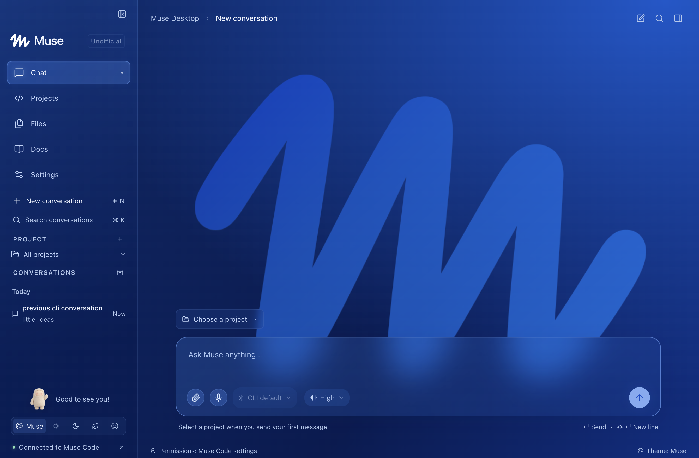
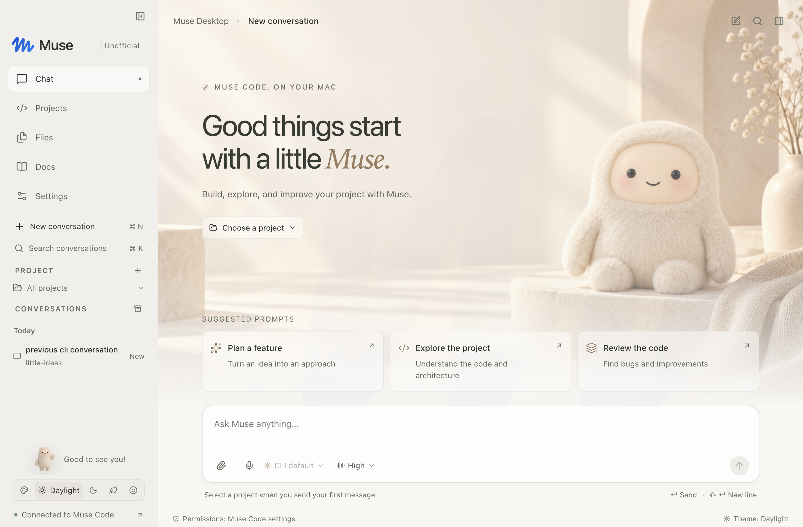
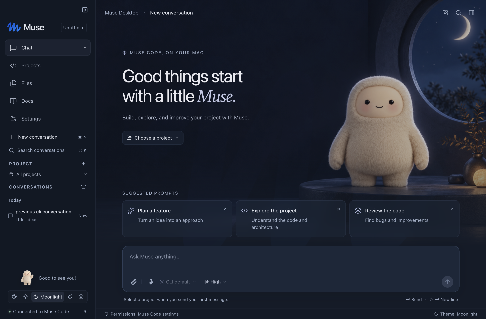
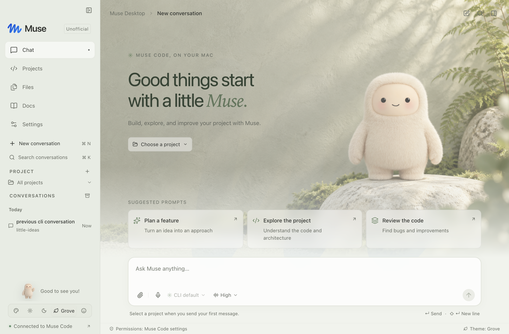
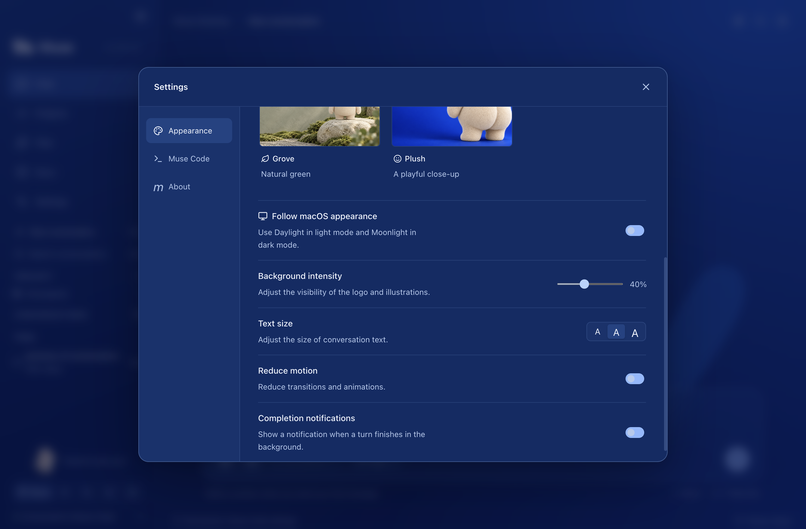

# Muse Desktop · Unofficial

[](https://github.com/robzilla1738/muse-desktop/actions/workflows/ci.yml)
[](LICENSE)
[](docs/compatibility.md)

**Unofficial community software by [Robert Courson (@robzilla1738)](https://github.com/robzilla1738). Not affiliated with, endorsed by, sponsored by, or supported by Meta.** Muse Code is a separate product of Meta. This repository provides the desktop companion, not the CLI or a Meta account.

A macOS home for Muse Code. Your installed CLI, existing sign-in, project settings, and saved conversations—with a desktop interface built around the way you work.



**[Download 0.1.0](https://github.com/robzilla1738/muse-desktop/releases/tag/v0.1.0)** — Developer ID signed by Robert Courson and notarized by Apple. Both Apple Silicon and Intel installers are available. CI artifacts are separate, unsigned development builds.

## What it does

- Discovers your existing `muse` installation, including your login-shell environment. No separate API key or desktop account.
- Streams real Muse conversations, reasoning summaries, tool activity, and stored output through the official SDK.
- Opens and resumes CLI sessions, with naming, search, pinning, local archiving, and Markdown export.
- Presents the CLI's exact approval choices and agent questions. Supports cancellation, queued follow-ups, and steering.
- Opens local projects, previews files, attaches text and images, and shows Git changes and diffs.
- Includes five themes: **Muse**, **Daylight**, **Moonlight**, **Grove**, and **Plush**, plus macOS appearance matching, text size, reduced motion, and optional completion notifications.
- Uses native window controls, file pickers, keyboard shortcuts, and project trust dialogs, with theme-matched in-app menus.
- Records voice with the microphone button or **Option–V**, transcribes through `muse voice transcribe`, and inserts text into the draft for review.
- Imports existing CLI conversation history and discovers its project folders automatically; internal reminders and hooks stay in the Activity inspector.
- Supports composer commands such as `/clear`, `/voice`, `/model`, `/effort`, `/compact`, and `/rename`; type `/` for suggestions.
- Opens the full Muse Code CLI from the project inspector for advanced administration and interactive terminal commands.
- Includes Sparkle 2 updates in packaged builds, with signed feeds and archives. Check manually in **Settings → About**, or opt into daily checks. Installation always requires your action.

<p> </p>
<p> </p>

## Install

| Mac                      | Download                                                                                                                |
| ------------------------ | ----------------------------------------------------------------------------------------------------------------------- |
| Apple Silicon (M-series) | [Apple Silicon DMG](https://github.com/robzilla1738/muse-desktop/releases/download/v0.1.0/Muse-Desktop-0.1.0-arm64.dmg) |
| Intel                    | [Intel DMG](https://github.com/robzilla1738/muse-desktop/releases/download/v0.1.0/Muse-Desktop-0.1.0-x64.dmg)           |

Requires macOS 13+ and a separately installed, signed-in Muse Code CLI. Open the DMG, drag **Muse Desktop** to **Applications**, and launch it. Desktop discovers your CLI and existing conversations. Use **Settings → Muse Code** if you need to select a custom executable. The first project you work in requires your trust confirmation.

Check for updates from **Muse Desktop → Check for Updates…** or **Settings → About**. Daily checks are optional. See [release verification and known limits](docs/release-readiness.md) and the [supported CLI workflows](docs/compatibility.md).

## Run locally

Requires macOS 13 or newer, Node.js 22.12 or newer, and Muse Code with `muse serve` support. Verified with Muse Code **1.4.7** and `@muse-code/sdk` **1.4.7**. The GUI does not bundle or install Muse Code. Packaging also requires Apple's Xcode Command Line Tools (`xcode-select --install`) to compile the small Sparkle bridge.

1. Install and sign in to Muse Code using the [official instructions](https://dev.meta.ai/docs/muse-code).
2. Check that `muse --version` works in Terminal.
3. In this repository, run:

```sh
npm ci
npm run dev
```

Open the packaged **Muse Desktop.app** when testing a standalone build. Opening the development Electron binary by itself displays Electron’s launcher. Renderer changes reload during development; restart `npm run dev` after changes to the main process or preload bridge.

Open a project, review its trust prompt, and send a message. Existing sessions and their project folders appear automatically. If detection fails, select the executable in **Settings → Muse Code** and reconnect.

## Build the Mac app

```sh
# Unsigned app bundle for your current Mac architecture
npm run package:unsigned

# Unsigned DMG for your current Mac architecture
npm run dist:unsigned
```

Artifacts go in `release/`. Local builds are unsigned and unnotarized; macOS may require an explicit first-open confirmation. See [release instructions](docs/releasing.md) for signed distribution, Apple Silicon and Intel builds, and checksums.

## Develop and verify

```sh
npm run typecheck
npm test
npm run build
npm run test:integration
npm run test:e2e
npm run format:check
```

Integration and desktop tests use the real CLI's **echo provider**, isolated temporary homes, and temporary projects. They do not need a model API key. Set `MUSE_BIN=/absolute/path/to/muse` if needed. Real model inference, your account's permissions, and external tools require an authenticated installation and are not exercised by echo tests.

The first-run setup test also runs without Muse Code: `npx playwright test tests/e2e/setup.spec.ts` after building. Release checks and remaining manual verification are recorded in [release readiness](docs/release-readiness.md).

The app is built with **Electron, React, TypeScript, electron-vite, and the official Muse SDK**. Electron lets the official Node SDK run directly in the main process, while the renderer is sandboxed behind a narrow typed bridge. No web service is required. See [architecture](docs/architecture.md), [compatibility](docs/compatibility.md), and [contributing](CONTRIBUTING.md).

## Data and permissions

The CLI remains responsible for credentials, model requests, tools, sandboxing, and session storage. Desktop does not rewrite CLI settings, store an additional copy of credentials, or add analytics. Model requests still reach the provider configured in Muse Code; “Local project” describes your files, not offline inference.

Desktop stores appearance, recent projects, project trust, pins, and archives in its Electron application-support directory. Voice audio goes only through your installed CLI and its transcription service. Temporary audio is deleted after completion or cancellation; voice text is never sent as a message automatically. Draft text is kept in memory and is not restored after quitting. Archiving only hides a conversation in Desktop; it does not delete the CLI session. Removing Desktop does not remove your CLI or its conversations.

Sparkle stores update preferences in macOS user defaults. Manual checks, or daily checks when enabled, connect to GitHub to retrieve the signed feed. Installing an update downloads its archive from GitHub Releases. System profiling is disabled; no conversations or project files are included in update requests.

## License and artwork

Source code is [MIT licensed](LICENSE). See [NOTICE](NOTICE.md) for the supplied Muse logo, mascot reference, generated artwork, and third-party licensing. Generation prompts are recorded in [docs/image-prompts.json](docs/image-prompts.json) and [docs/plush-image-prompt.json](docs/plush-image-prompt.json). Trademark and reference-image rights are separate from the source-code license.
